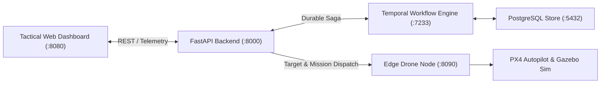

# Intent-Swarm-Commander: Documentation Hub

Welcome to the **Intent-Swarm-Commander (ISC v0.2.0)** architectural and operational documentation suite.

> **Printable Architecture Manual**: A complete 53-page publication-grade PDF containing all architecture documents, sequence diagrams, deployment maps, DDD context models, and the Poor-Man's Artemis.IA integration analysis with fully pre-rendered vector graphics is available at:  
> **[Download Intent-Swarm-Commander-Architecture.pdf](file:///home/remi/Projects/Intent-Swarm-Commander/docs/Intent-Swarm-Commander-Architecture.pdf)**

---

## Documentation Index

| Document | Primary Audience | Scope & Key Contents |
| :--- | :--- | :--- |
| **[System Architecture](file:///home/remi/Projects/Intent-Swarm-Commander/docs/system_architecture.md)** | System Architects, Engineers | The compliant 7-step pipeline (MCP, HITL, Guardian Critic), 3-tier system architecture, and core subsystems. |
| **[Data Flows & Sequence Diagrams](file:///home/remi/Projects/Intent-Swarm-Commander/docs/data_flows.md)** | Developers, Integrators | Sequence diagrams for SMEAC submission, multi-agent decomposition, safety verification, HITL approval, edge flight execution, telemetry loops, and JIT auth. |
| **[Deployment Architecture](file:///home/remi/Projects/Intent-Swarm-Commander/docs/deployment.md)** | DevOps, Field Engineers | Infrastructure topologies across Command Post, Tactical Edge (Raspberry Pi 5, Pixhawk 6C), and Simulation (ROS 2 Humble, Gazebo Harmonic, PX4 SITL), port mappings, and container specs. |
| **[Domain-Driven Design (DDD)](file:///home/remi/Projects/Intent-Swarm-Commander/docs/domain_driven_design.md)** | Backend Engineers, Domain Experts | Strategic Bounded Contexts, Ubiquitous Language, Context Map, Aggregates, Entities, Value Objects, and the `uservice-template` clean architecture layers. |
| **[System, Service & Entity Overview](file:///home/remi/Projects/Intent-Swarm-Commander/docs/service_and_entity_overview.md)** | Database Admins, API Consumers | Detailed service-by-service catalog, API endpoints, Entity-Relationship (ER) diagram, table schemas, constraints, and state transition lifecycles. |
| **[PMA Integration Analysis](file:///home/remi/Projects/Intent-Swarm-Commander/docs/analysis/compatibility_with_pma.md)** | Strategic Planners, Data Engineers | Deep architectural synergy and integration roadmap with Poor-Man's Artemis.IA data lakehouse. |

---

## Core System Architecture Quick Summary

