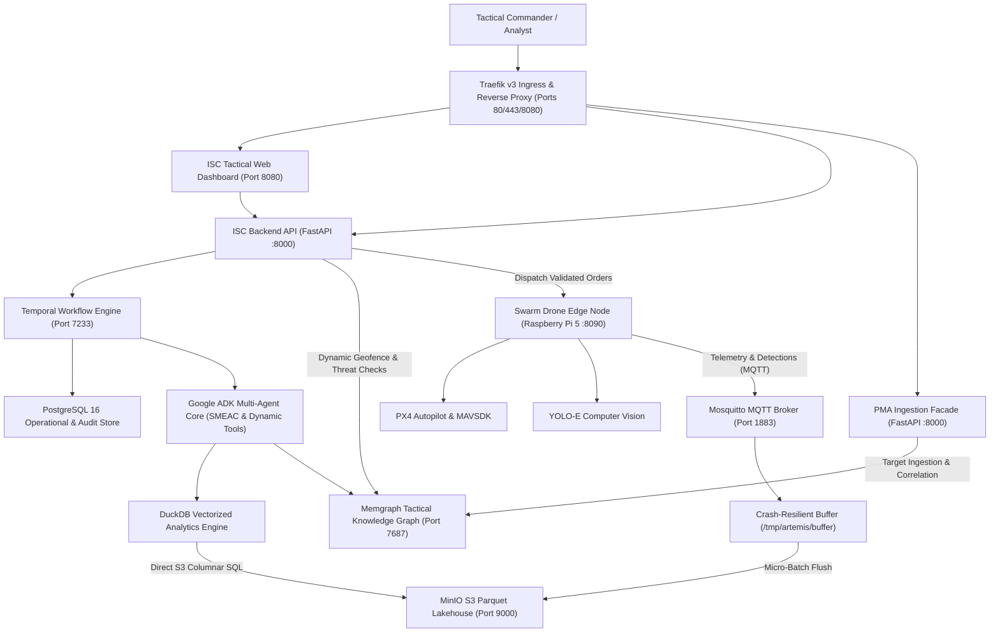

# Architectural Integration & Deep Analysis: Intent-Swarm-Commander & Poor-Man's Artemis.IA

**Document ID:** `DOC-ANALYSIS-ISC-PMA-001`  
**Date:** October 2026  
**Status:** Approved for Design Integration  
**Target Repository:** `Intent-Swarm-Commander` (v0.2.0)  
**Partner Repository:** `Poor-Man-s-Artemis.IA` (v0.2.0)  

---

## 1. Executive Summary

**Intent-Swarm-Commander (ISC)** is a tactical multi-drone swarm command-and-control (C2) system designed to decompose high-level military intents (**SMEAC**: Situation, Mission, Execution, Administration/Logistics, Command/Signal) into synchronized drone flight trajectories, automated computer-vision target recognition (YOLO-E), and durable Temporal workflows.

**Poor-Man's Artemis.IA (PMA)** is an ultra-lean, sovereign big data lakehouse and AI infostructure inspired by the French Ministry of Armed Forces' ARTEMIS.IA program. Engineered to run completely on a single commodity Linux VM (16–32 GB RAM, CPU-only) with **zero JVM overhead**, PMA provides high-throughput MQTT telemetry ingestion (Eclipse Mosquitto), columnar Parquet object storage (MinIO), sub-second vectorized SQL analytics (DuckDB), in-memory graph knowledge discovery (Memgraph), and autonomous multi-agent reasoning (Google ADK 2.0 / Gemini).

### The Strategic Value Proposition
Currently, **Intent-Swarm-Commander** operates with ephemeral in-memory state for drone telemetry, a polling-based HTTP interface for edge drones, static JSON configuration for restricted airspaces, and no capability for long-term telemetry retention or historical fleet analytics.

Integrating **Poor-Man's Artemis.IA** into **Intent-Swarm-Commander** transforms ISC from a local drone flight dispatcher into a full-scale **C4ISR (Command, Control, Communications, Computers, Intelligence, Surveillance, and Reconnaissance)** platform. This integration unlocks:
1. **High-Throughput Swarm Telemetry Ingestion**: Scalable MQTT ingestion bus handling hundreds of simultaneous UAV telemetry streams without HTTP polling bottlenecks.
2. **Columnar Lakehouse & After-Action Review (AAR)**: Persistent Parquet storage on MinIO with sub-second DuckDB SQL queries over historical flight paths, battery degradation, and mission logs.
3. **Dynamic Battlefield Knowledge Graph**: Memgraph-powered tactical situational awareness, replacing static geofence files with dynamic threat envelopes (SAMs, radars, jammer ranges, and OSINT targets).
4. **Sensor Fusion & Target Identification Lineage**: Logging and cross-referencing YOLO-E edge computer vision detections with adversary intelligence entities.
5. **Intelligence-Driven SMEAC Drafting**: Autonomous agentic reasoning leveraging DuckDB and Memgraph tools to answer complex commander queries and draft SMEAC orders automatically.

---

## 2. Architectural Comparison & Synergy Matrix

Both systems were built following identical software engineering principles from the [`uservice-template`](https://github.com/dotness/uservice-template) standard: Domain-Driven Design (DDD), Clean/Hexagonal Architecture (`api`, `facade`, `operations`, `models`), asynchronous Temporal workflow orchestration, Pydantic type safety, and JWT Bearer security.

### 2.1 Component Comparison

| Functional Tier | Intent-Swarm-Commander (Current) | Poor-Man's Artemis.IA (PMA) | Synergy & Target Integrated State |
| :--- | :--- | :--- | :--- |
| **Telemetry Ingress** | Ephemeral HTTP polling (`GET :8090/telemetry`) | Eclipse Mosquitto MQTT (`:1883`, C-native, 1,000+ evt/s) | **MQTT Telemetry Bus**: Edge drones stream MAVLink telemetry directly to Mosquitto. |
| **Long-Term Storage** | PostgreSQL 15 (transactional tables only) | MinIO (S3-compatible, partitioned Parquet) | **S3 Lakehouse**: Mission history and high-frequency sensor readings stored in Parquet objects. |
| **Analytical Query Engine** | None (PostgreSQL basic queries) | DuckDB (Embedded C++, vectorized columnar engine) | **Vectorized AAR**: Fleet-wide analytics, heatmaps, and telemetry anomaly detection in < 1 second. |
| **Tactical Context / Graph** | Static JSON (`config/restricted_zones.json`) | Memgraph (`:7687`, C++ property graph, openCypher) + KDG | **Tactical Knowledge Graph**: Dynamic threat zones, target tracking, electronic warfare envelopes. |
| **Orchestration** | Temporal Server (`:7233`) | Temporal Server (`:7233`) + Ephemeral Docker Runner | **Unified Workflow Engine**: Shared or federated Temporal orchestrator for orders and data pipelines. |
| **Multi-Agent AI** | Pydantic-AI (SMEAC Parser & Critic) | Google ADK 2.0 (`DynamicAgentLoop` with 6 dynamic DB tools) | **Dynamic Tool Loop**: Agents can inspect live telemetry and knowledge graphs to suggest SMEAC orders. |
| **Edge Compute** | Raspberry Pi 5 (FastAPI, YOLO-E, MAVSDK, PX4) | MQTT client publishers (`paho-mqtt`) | **Edge Telemetry Publisher**: Pi 5 publishes state and YOLO detections directly to the message bus. |
| **Access Control & Proxy** | Custom JWT Middleware & Proxy | Traefik v3 + Project Membership RBAC | **Unified Tactical Gateway**: Authenticated ingress and reverse proxy across all services. |

---

## 3. End-to-End Integrated Architecture

The combined system bridges tactical edge operations with deep intelligence analytics. The diagram below illustrates how components from both projects interact:



---

## 4. Key Integration Capabilities & Technical Blueprints

### 4.1 High-Frequency Swarm Telemetry Ingestion (MQTT Bus)

#### Current State in ISC
In `src/edge/api/server.py`, drone telemetry (latitude, longitude, altitude, battery percentage, heading) is maintained in a local Python dictionary `_telemetry_state` and exposed via `GET /telemetry`. The dashboard or backend must periodically poll each drone over HTTP. In a swarm of 20 to 100 drones operating over lossy tactical radios, polling creates severe latency, bandwidth saturation, and connection dropouts.

#### Integrated Blueprint with PMA
Replace edge HTTP polling with push-based MQTT streaming over PMA's **Eclipse Mosquitto** broker:
1. **Topic Hierarchy**:
   ```
   telemetry/swarms/<swarm_id>/<drone_id>/navigation
   telemetry/swarms/<swarm_id>/<drone_id>/battery
   telemetry/swarms/<swarm_id>/<drone_id>/detections
   telemetry/swarms/<swarm_id>/<drone_id>/health
   ```
2. **QoS Protocol**:
   - Navigation and high-frequency IMU telemetry use **QoS 0** (At most once) to prevent edge message queue saturation.
   - High-priority state changes (battery low alert, safety geofence breach, target identification) use **QoS 1** (At least once).
3. **Payload Data Contract**:
   ```json
   {
     "timestamp": "2026-10-24T09:15:30.120Z",
     "swarm_id": "alpha_squadron",
     "drone_id": "uav_04",
     "metric": "navigation",
     "value": {
       "lat": 48.8584,
       "lon": 2.2945,
       "alt_m": 120.5,
       "heading_deg": 184.2,
       "groundspeed_ms": 14.8
     },
     "metadata": {
       "flight_mode": "mission",
       "firmware": "px4_v1.14"
     }
   }
   ```

### 4.2 Edge Computer Vision Sensor Fusion & Target Intelligence

#### Current State in ISC
In `src/edge/vision/inference.py`, the `YoloEInference` engine processes camera frames on the Raspberry Pi 5 to detect target classes (e.g. `vehicle`, `person`, `tank`). Detections are consumed locally by `FlightController` for tracking, but are not persisted or correlated with battlefield command intelligence.

#### Integrated Blueprint with PMA
1. **Detection Stream to MQTT**:
   When YOLO-E detects an object matching the SMEAC target profile with confidence above threshold:
   ```json
   {
     "timestamp": "2026-10-24T09:16:02.450Z",
     "swarm_id": "alpha_squadron",
     "drone_id": "uav_04",
     "metric": "detection",
     "value": {
       "target_class": "armored_vehicle",
       "confidence": 0.89,
       "bbox": [320, 180, 480, 310],
       "estimated_gps": {
         "lat": 48.8591,
         "lon": 2.2960
       }
     },
     "metadata": {
       "mission_id": "smeac_recon_089",
       "snapshot_uri": "s3://telemetry/snapshots/2026/10/24/uav_04_det_1042.jpg"
     }
   }
   ```
2. **Snapshot Storage in MinIO**:
   Low-resolution cropped bounding boxes (target thumbnails) are asynchronously uploaded to MinIO S3 bucket `tactical-snapshots`, providing visual ground-truth evidence for HITL commander validation.
3. **Memgraph Entity Creation**:
   PMA's ingestion pipeline extracts the detection event and creates a `:TargetObservation` node in Memgraph linked to `:UAV` and `:SMEAC_Mission`.

### 4.3 Vectorized After-Action Review (AAR) via DuckDB

#### Capability Overview
Modern military drone doctrine requires comprehensive After-Action Reviews: analyzing drone performance, tracking detection density, assessing airspace deconfliction, and inspecting battery consumption curves.

PMA's native **DuckDB client** queries MinIO Parquet files directly using vectorized SIMD execution without requiring Spark or Trino clusters:
```sql
-- Query: Average battery depletion rate and flight time per drone in mission
SELECT 
    drone_id,
    MIN(CAST(value->>'alt_m' AS DOUBLE)) AS min_altitude,
    MAX(CAST(value->>'alt_m' AS DOUBLE)) AS max_altitude,
    AVG(CAST(value->>'groundspeed_ms' AS DOUBLE)) AS avg_speed,
    MAX(timestamp) - MIN(timestamp) AS mission_duration,
    (MAX(CAST(value->>'battery' AS DOUBLE)) - MIN(CAST(value->>'battery' AS DOUBLE))) AS battery_consumed
FROM 's3://telemetry/swarms/alpha_squadron/**/*.parquet'
WHERE timestamp >= '2026-10-24T08:00:00Z'
GROUP BY drone_id
ORDER BY battery_consumed DESC;
```
This enables the ISC Tactical Dashboard to render instant post-flight analytics, flight playback histograms, and predictive maintenance warnings for UAV motors and batteries.

### 4.4 Dynamic Battlefield Knowledge Graph & Threat-Aware Safety Critic

#### Current State in ISC
In `src/uservice/swarm/operations/swarm_agents.py`, the `GuardianCriticAgent` enforces safety rules using a static JSON file:
```python
# src/uservice/swarm/operations/swarm_agents.py
config_path = os.path.join(base_dir, "config", "restricted_zones.json")
```
This static approach cannot handle dynamic battlefield conditions: mobile enemy air defense units (SAMs), active radar detection domes, changing friendly artillery corridors, or civilian gathering zones.

#### Integrated Blueprint with Memgraph
PMA provides **Memgraph** with high-speed Cypher graph queries and geospatial index support.
1. **Tactical Graph Schema**:
   - Nodes:
     - `(:Swarm {id, callsign, status})`
     - `(:Drone {id, serial_number, battery_level, payload_type})`
     - `(:SMEAC_Order {id, commander_id, status, objective})`
     - `(:ThreatZone {id, type, min_alt, max_alt, threat_level, radius_m, polygon})`
     - `(:RadarStation {id, frequency_band, detection_range_km, azimuth})`
     - `(:ObservedEntity {id, class_name, confidence, first_seen, last_seen})`
   - Relationships:
     - `(:Drone)-[:ASSIGNED_TO]->(:Swarm)`
     - `(:Swarm)-[:EXECUTING]->(:SMEAC_Order)`
     - `(:ThreatZone)-[:OVERLAPS]->(:RestrictedAirspace)`
     - `(:Drone)-[:DETECTED {timestamp, confidence}]->(:ObservedEntity)`
2. **Dynamic Threat Gating in Guardian Critic**:
   Instead of checking a static file, the Guardian Critic executes an openCypher query via PMA's `GraphFacade`:
   ```cypher
   MATCH (t:ThreatZone)
   WHERE t.active = true 
     AND point.distance(point({latitude: $lat, longitude: $lon}), point({latitude: t.lat, longitude: t.lon})) < t.radius_m
   RETURN t.id AS threat_id, t.type AS threat_type, t.threat_level AS threat_level
   ```
   If any threat intersects the proposed flight path, the Guardian Critic immediately flags a violation with exact threat intelligence data.

### 4.5 Intelligence-Driven SMEAC Synthesis (PMA DynamicAgentLoop)

PMA's `DynamicAgentLoop` (`src/domains/ai/operations/dynamic_loop.py`) equips LLM agents with 6 autonomous database tools:
- `execute_project_query`: Runs arbitrary read-only SQL on DuckDB over Parquet telemetry.
- `query_knowledge_graph`: Runs read-only Cypher on Memgraph.
- `discover_workspace_schema`: Inspects available datasets and metadata.
- `find_cross_project_entities`: Correlates entities across projects using fuzzy matching.
- `get_data_lineage`: Inspects source-to-target data dependencies.
- `describe_entity`: Retrieves 1-hop subgraphs for tactical targets.

#### Tactical Workflow
A commander on the ISC Tactical Dashboard can prompt the assistant:
> *"Plan a reconnaissance mission over Sector Delta. Avoid areas where hostile mobile radar was detected in the last 24 hours, and deploy drones with at least 80% battery capacity."*

1. **Step 1 (Graph Query)**: The agent queries Memgraph for active hostile radar locations and their detection cones in Sector Delta.
2. **Step 2 (Lakehouse Query)**: The agent runs DuckDB SQL over the latest telemetry to identify UAVs in the fleet currently sitting at $\ge 80\%$ battery.
3. **Step 3 (Plan Synthesis)**: The agent constructs a draft SMEAC order with a deconflicted flight path around the radar domes.
4. **Step 4 (HITL Approval Gate)**: The drafted order is submitted directly to ISC's HITL approval screen for human confirmation before launch.

---

## 5. Infrastructure Coexistence & Deployment Strategy

Both systems use Docker Compose for local execution. Running both simultaneously requires clean network bridging and non-conflicting port allocation.

### 5.1 Port Allocation Matrix

| Service | ISC Standalone Port | PMA Standalone Port | Coexistence Strategy |
| :--- | :--- | :--- | :--- |
| **PostgreSQL** | `5432` | `5433` (mapped from 5432) | Keep separated: ISC uses `5432`, PMA uses `5433` to prevent database schema contamination. |
| **Temporal gRPC** | `7233` | `7233` | **Option A (Recommended)**: ISC points to PMA's Temporal service with separate task queues (`ISC_TASK_QUEUE` vs `PMA_TASK_QUEUE`).<br>**Option B**: Map PMA Temporal to `7234`. |
| **Temporal UI** | None | `8233` (host) | Accessible to monitor both ISC and PMA workflows simultaneously on `http://localhost:8233`. |
| **MQTT Broker** | None | `1883` | Dedicated to PMA; ISC edge drones publish to `localhost:1883`. |
| **MinIO S3 API** | None | `9000` | S3 API accessible by ISC backend and DuckDB. |
| **MinIO Web Console**| None | `9001` | S3 lakehouse browser accessible on `http://localhost:9001`. |
| **Memgraph Bolt** | None | `7687` | Memgraph Bolt port accessible by ISC Guardian Critic via `neo4j` or `gqlalchemy`. |
| **Redis Cache** | None | `6379` | Dedicated to PMA semantic caching and rate limiting. |
| **Traefik Gateway** | None | `80`, `443`, `8088` | Traefik proxies ISC dashboard (`:8080`), ISC backend (`:8000`), and PMA APIs. |
| **ISC Edge Node** | `8090` | None | Dedicated to ISC edge drone server. |
| **Dashboard UI** | `8080` | None | Host on `8080` or route via Traefik host routing (`c2.artemis.local`). |

### 5.2 Network Bridge Configuration

To allow ISC backend and edge containers to reach PMA services without host networking hacks, create a shared Docker bridge network in `docker-compose.yml`:

```yaml
networks:
  c2-shared-net:
    name: c2-shared-net
    driver: bridge
```

In `Intent-Swarm-Commander/docker-compose.yml`:
```yaml
services:
  backend:
    networks:
      - c2-shared-net
    environment:
      - MQTT_HOST=artemis-mosquitto
      - MQTT_PORT=1883
      - MEMGRAPH_URI=bolt://artemis-memgraph:7687
      - MINIO_ENDPOINT=artemis-minio:9000
```

---

## 6. Implementation Roadmap

The integration can be executed incrementally across four modular phases without breaking any existing ISC MVP features:

### Phase 1: Swarm Telemetry Streamer & Lakehouse Archival
* **Objective**: Stream live drone telemetry to Mosquitto and persist it into MinIO Parquet partitions.
* **Tasks**:
  1. Add `paho-mqtt` dependency to `src/edge/` and `src/uservice/`.
  2. Implement an asynchronous MQTT publisher inside `src/edge/api/server.py` in the `telemetry_loop()` function.
  3. Configure PMA's ingestion pipeline to route `telemetry/swarms/#` topics into partitioned S3 Parquet tables.
  4. Verify data arrival in MinIO using DuckDB CLI.

### Phase 2: Dynamic Threat Intelligence & Memgraph Safety Gating
* **Objective**: Replace static geofencing in `GuardianCriticAgent` with dynamic openCypher queries against Memgraph.
* **Tasks**:
  1. Add `neo4j` driver to `src/uservice/swarm/operations/swarm_agents.py`.
  2. Implement `query_threat_zones(lat, lon, radius)` calling Memgraph.
  3. Build an initial seed script to populate battlefield threats (SAM batteries, radar zones, temporary flight restrictions) into Memgraph.
  4. Update `check_geofencing()` to perform spatial distance queries against Memgraph threat nodes.

### Phase 3: Sensor Fusion & Perception Logging
* **Objective**: Ingest YOLO-E detections and snapshots into the Big Data Lakehouse and Knowledge Discovery Graph.
* **Tasks**:
  1. In `src/edge/vision/inference.py`, dispatch detection payloads to `telemetry/swarms/<swarm_id>/<drone_id>/detections`.
  2. Implement image thumbnail upload to MinIO bucket `tactical-snapshots`.
  3. In PMA, configure entity linking to associate target observations with active SMEAC missions in Memgraph.

### Phase 4: Tactical AI Copilot & After-Action Analytics
* **Objective**: Expose DuckDB analytics and PMA's multi-agent dynamic tools to the Tactical Dashboard.
* **Tasks**:
  1. Add an AAR Analytics tab in `src/dashboard/index.html` querying DuckDB via PMA's `/api/v1/analytics/query`.
  2. Connect the SMEAC order generator to PMA's `DynamicAgentLoop` for automated reconnaissance mission drafting.
  3. Integrate Temporal UI (`:8233`) into the Commander dashboard for end-to-end mission workflow tracing.

---

## 7. Risk Analysis & Mitigation

| Identified Risk | Severity | Technical Impact | Mitigation Strategy |
| :--- | :--- | :--- | :--- |
| **Tactical Link Disconnection (DDIL / Jamming)** | High | Edge drones cannot reach central Mosquitto broker during EW interference. | Drones utilize local SQLite/disk buffering (`/tmp/edge_buffer.jsonl`) on the Pi 5; automatically flush queued telemetry via bulk replay once MQTT connection is restored. |
| **Port Conflicts on Host Machine** | Medium | Docker compose fail on startup if both projects use port 5432 or 7233. | Use non-overlapping port mappings (`5433` for PMA Postgres, `8233` for Temporal UI) and use Docker internal DNS names across a shared bridge network (`c2-shared-net`). |
| **Resource Contention on Local VM** | Low | Simultaneous Gazebo simulation, ROS 2, and Big Data stack exceeding VM memory. | PMA's Zero-JVM architecture consumes < 12 GB RAM idle. If running Gazebo on the same host, allocate swap or offload Gazebo rendering to headless mode (`PX4_GZ_STANDALONE=1`). |
| **Data Leaks Across Mission Boundaries** | Medium | Multi-swarm telemetry mixed together in shared storage. | Enforce PMA's Project RBAC and Medallion architecture: each swarm or operational theater is assigned an isolated `project_id` with strict S3 prefix confinement. |

---

## 8. Conclusion & Recommendation

The combination of **Intent-Swarm-Commander** and **Poor-Man's Artemis.IA** creates a synergistic military-grade drone C2 and tactical intelligence platform. 

- **ISC** provides the physical actuation, ROS 2 / PX4 flight control, SMEAC intent parsing, and edge perception.
- **PMA** provides the enterprise data backbone: resilient high-throughput telemetry buses, zero-JVM lakehouse storage, sub-second columnar fleet analytics, and dynamic graph-based threat awareness.

It is recommended to proceed with **Phase 1 (MQTT Telemetry Streaming)** and **Phase 2 (Memgraph Dynamic Geofencing)** as the immediate next steps to replace ISC's mock and polling bottlenecks with production-grade data pipelines.
