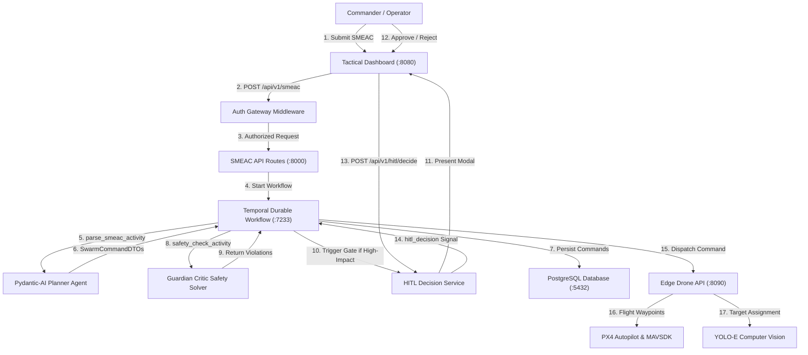
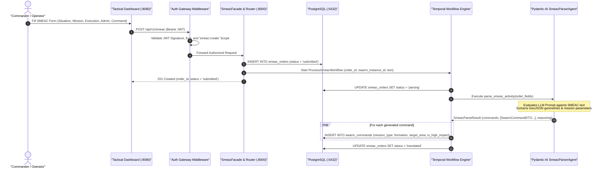
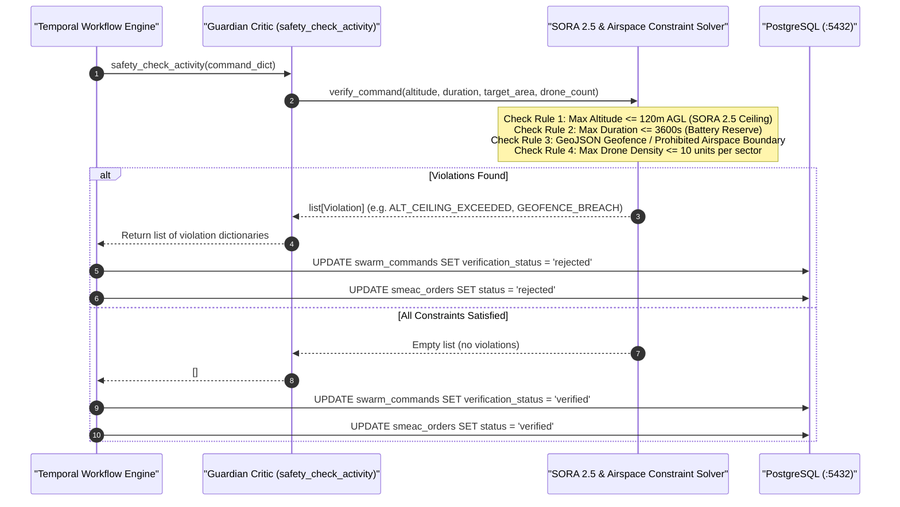
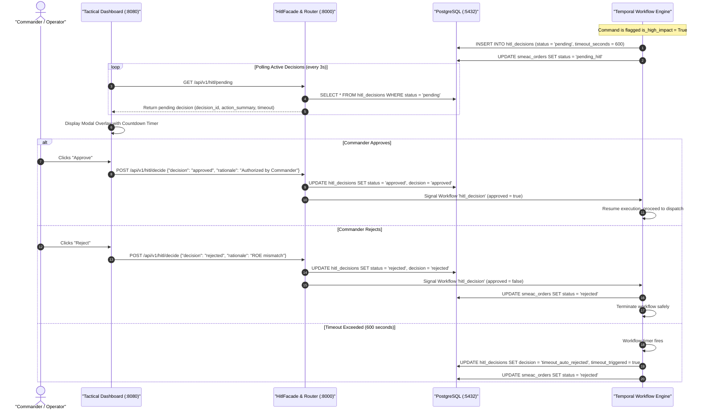
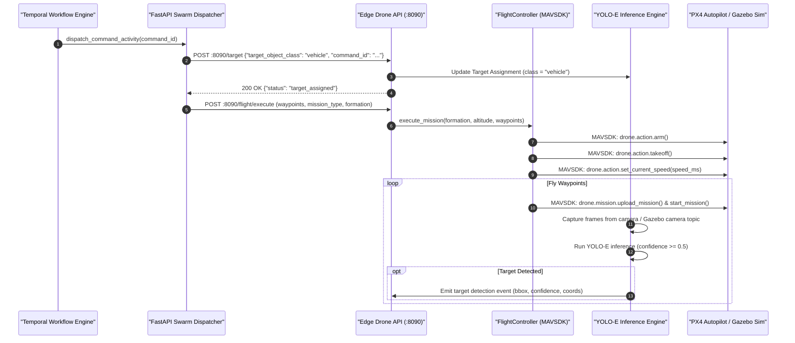
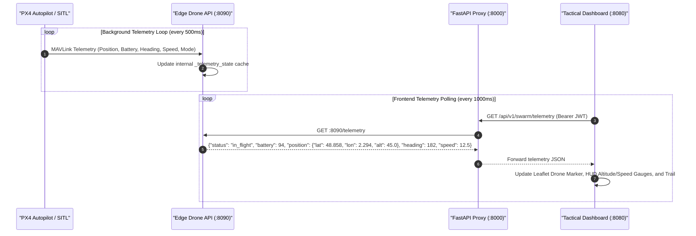
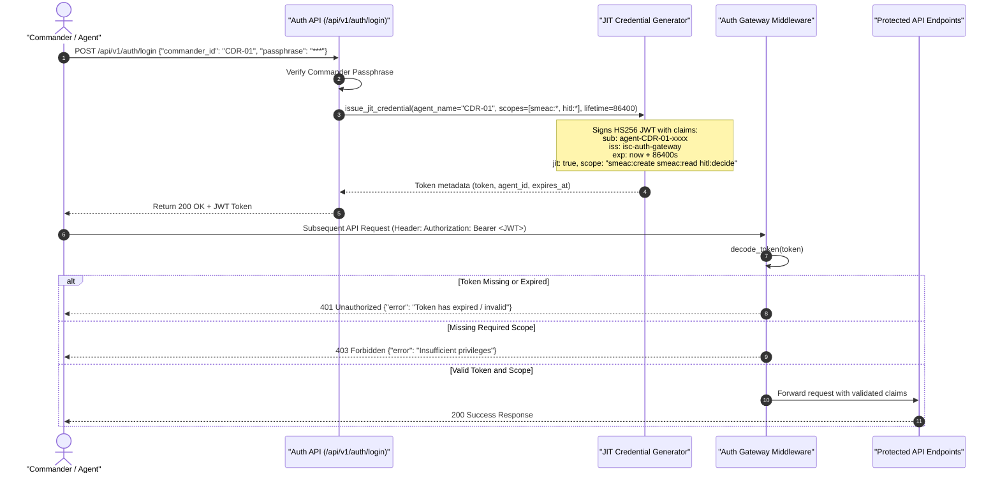

# Intent-Swarm-Commander: Data Flows & Sequence Diagrams

This document details the operational data flows within **Intent-Swarm-Commander (ISC)**. It covers the end-to-end journey of tactical orders, safety verification, human approvals, edge execution, and real-time telemetry streaming.

---

## 1. End-to-End Data Flow Overview

---

## 2. Flow 1: SMEAC Order Submission & Multi-Agent Decomposition

When a commander submits a military operation order through the dashboard, it is structured according to the SMEAC military standard and decomposed into coarse-grained swarm commands by an LLM agent.

### Sequence Diagram

### Detailed Steps:
1. **Payload Submission**: The commander inputs mission parameters into [`main.js`](file:///home/remi/Projects/Intent-Swarm-Commander/src/dashboard/js/main.js). The frontend bundles this into a [`SmeacOrderCreateRequest`](file:///home/remi/Projects/Intent-Swarm-Commander/src/uservice/smeac/models/contract/schemas.py).
2. **Authentication Gate**: [`auth_gateway_middleware`](file:///home/remi/Projects/Intent-Swarm-Commander/src/uservice/security/middleware.py) intercepts the request, decoding the JWT and verifying the `smeac:create` permission.
3. **Initial Persistence**: [`SmeacFacade`](file:///home/remi/Projects/Intent-Swarm-Commander/src/uservice/smeac/facade/smeac.py) creates an initial record in the `smeac_orders` table with status `submitted`.
4. **Workflow Execution**: The durable workflow [`ProcessSmeacWorkflow`](file:///home/remi/Projects/Intent-Swarm-Commander/src/uservice/smeac/operations/process.py) is triggered via the Temporal client.
5. **Agent Inference**: The workflow launches `parse_smeac_activity`, which invokes the [`SmeacParserAgent`](file:///home/remi/Projects/Intent-Swarm-Commander/src/uservice/smeac/operations/smeac_agents.py). The LLM decomposes the intent into formal parameters:
   - `mission_type`: recon, patrol, strike, transport, escort, or abort.
   - `formation_type`: line, wedge, diamond, spread, or stack.
   - `target_area`: Valid GeoJSON (LineString for patrols/transits, Polygon for surveillance zones).
   - `drone_count`, `altitude_m`, `speed_ms`, `duration_s`, and `priority`.
6. **Command Storage**: Each decomposed command is saved to `swarm_commands`, flagged as high-impact if `mission_type` is in `["strike", "abort"]`.

---

## 3. Flow 2: Safety Verification & Guardian Critic Solvers

Before any command can be dispatched to physical hardware or simulation, it must undergo formal safety checks to prevent airspace violations, collisions, or flight envelope exceedances.

### Sequence Diagram

### Constraint Checking Specifications:
* **Altitude Ceiling Enforcement**: Evaluated against standard civilian/military joint airspace regulations (maximum 120 meters Above Ground Level).
* **Battery Endurance Limits**: Operational durations exceeding 3,600 seconds trigger a `DURATION_EXCEEDED` violation to preserve mandatory return-to-launch (RTL) battery reserves.
* **Geofence Deconfliction**: GeoJSON coordinates are checked against restricted airspace zones loaded from [`config/restricted_zones.json`](file:///home/remi/Projects/Intent-Swarm-Commander/config/restricted_zones.json).
* **Swarm Density Bounds**: Enforces maximum simultaneous unit allocations per target grid to eliminate mid-air collision hazards.

---

## 4. Flow 3: Human-in-the-Loop (HITL) Approval Gate

High-impact actions (kinetic strikes, mission aborts, or ROE overrides) mandate explicit human commander confirmation under EU AI Act requirements.

### Sequence Diagram

---

## 5. Flow 4: Tactical Edge Dispatch & Drone Flight Execution

Once commands pass safety verification and HITL approval, they are transmitted to the edge node to drive physical autopilots or simulation bridges.

### Sequence Diagram

---

## 6. Flow 5: Real-time Telemetry Collection & Dashboard HUD

The tactical map maintains live positional awareness by polling the backend proxy, which aggregates telemetry from edge drones.

### Sequence Diagram

---

## 7. Flow 6: JIT Ephemeral Credential Lifecycle & Auth Gateway

To eliminate credential sprawl and protect the C2 perimeter, agents and operators request time-bounded Just-In-Time (JIT) JWTs.

### Sequence Diagram

