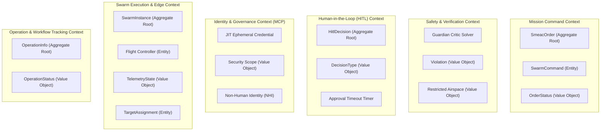
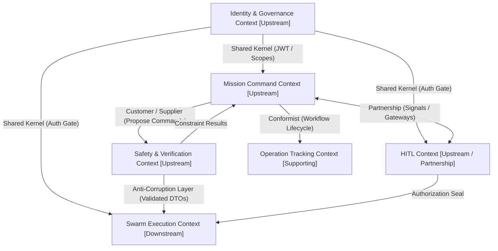
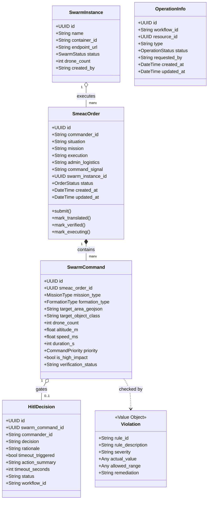

# Intent-Swarm-Commander: Domain-Driven Design (DDD) & Context Architecture

This document details the **Domain-Driven Design (DDD)** architecture of **Intent-Swarm-Commander (ISC v0.2.0)**, covering Bounded Contexts, the Strategic Context Map, Aggregates, Entities, Value Objects, and the tactical layered architecture derived from the [`uservice-template`](https://github.com/dotness/uservice-template) standard.

---

## 1. Strategic DDD: Bounded Contexts & Ubiquitous Language

ISC partitions complex multi-drone autonomous command operations into five core bounded contexts and one supporting infrastructure context:



### 1.1 Bounded Context Definitions

#### A. Mission Command Context
* **Core Responsibility**: Ingestion, semantic decomposition, and lifecycle management of tactical military orders.
* **Ubiquitous Language**:
  * *SMEAC Order*: A standardized 5-paragraph military operations order comprising Situation, Mission, Execution, Administration/Logistics, and Command/Signal.
  * *Coarse-Grained Operator*: A high-level swarm maneuver (e.g. `recon`, `patrol`, `strike`, `transport`) abstracted from low-level flight dynamics.
  * *Formation Type*: Swarm geometry in transit or on station (`line`, `wedge`, `diamond`, `spread`, `stack`).
  * *Order Lifecycle*: Transition states: `draft` -> `submitted` -> `parsing` -> `translated` -> `verified` -> `pending_hitl` -> `executing` -> `completed` / `rejected` / `failed`.

#### B. Safety & Verification Context (Guardian Critic)
* **Core Responsibility**: Deterministic safety verification, geofence boundary enforcement, and SORA 2.5 risk modeling prior to physical command execution.
* **Ubiquitous Language**:
  * *Guardian Critic*: Autonomous deterministic evaluation engine checking operational safety boundaries.
  * *SORA 2.5 Envelope*: Specific Operations Risk Assessment compliance rules governing maximum altitude (120m AGL), return-to-launch battery buffers, and maximum drone densities.
  * *Airspace Geofence*: 2D/3D polygonal no-fly zone (prohibited, restricted, or danger areas).
  * *Violation*: A formal constraint breach accompanied by rule ID, severity (`critical`, `warning`), actual value, allowed threshold, and suggested remediation.

#### C. Human-in-the-Loop (HITL) Context
* **Core Responsibility**: Durable human oversight, escalation policies, and regulatory approval gates for irreversible actions.
* **Ubiquitous Language**:
  * *High-Impact Action*: Irreversible kinetic or mission-altering operations (`strike`, `abort`, ROE change).
  * *Decision Gate*: Asynchronous pause in the mission workflow requiring explicit commander cryptographic authorization.
  * *Timeout Policy*: Failsafe countdown (default 600 seconds) after which an unconfirmed high-impact command fails closed (`timeout_auto_rejected`).

#### D. Identity & Governance Context (MCP Control Plane)
* **Core Responsibility**: Non-Human Identity (NHI) governance, Enterprise-Managed Authorization (EMA), and dynamic credential issuance.
* **Ubiquitous Language**:
  * *Just-In-Time (JIT) Credential*: Ephemeral cryptographic JWT issued dynamically with short expiration to prevent credential sprawl.
  * *RBAC Scope*: Fine-grained capability string (e.g. `smeac:create`, `hitl:decide`, `swarm:execute`).
  * *Fail-Closed Middleware*: Security chokepoint terminating any unauthenticated or unauthorized request with HTTP 401/403.

#### E. Swarm Execution & Tactical Edge Context
* **Core Responsibility**: Fleet orchestration, hardware companion computer daemons, MAVLink autopilot bridge, and onboard perception.
* **Ubiquitous Language**:
  * *Swarm Instance*: A registered pool of physical or simulated UAV units allocated to a mission.
  * *Target Assignment*: Detection class assignment (e.g. `vehicle`, `person`) forwarded to edge computer vision.
  * *YOLO-E Perception*: Real-time edge inference classifying optical targets with confidence scoring.
  * *MAVSDK Bridge*: Asynchronous communication bridge transmitting MAVLink waypoints to PX4 Autopilot.

#### F. Operation & Workflow Tracking Context
* **Core Responsibility**: Distributed saga tracking, execution durability, and immutable audit trails across asynchronous activities.
* **Ubiquitous Language**:
  * *Workflow ID*: Unique Temporal execution handle coordinating multi-step mission workflows.
  * *Operation Status*: High-level distributed process state (`created`, `ongoing`, `completed`, `failed`).

---

## 2. Strategic DDD: Context Map & Inter-Context Relationships

The relationship between contexts is governed by strict integration patterns (Customer-Supplier, Conformist, Shared Kernel, and Anti-Corruption Layer):



### Relationship Design Patterns
1. **Shared Kernel (`Identity & Governance` <-> All Contexts)**: The security models ([`jwt.py`](file:///home/remi/Projects/Intent-Swarm-Commander/src/uservice/security/jwt.py), [`jit.py`](file:///home/remi/Projects/Intent-Swarm-Commander/src/uservice/security/jit.py)) and user identity context are shared across all API routes via [`auth_gateway_middleware`](file:///home/remi/Projects/Intent-Swarm-Commander/src/uservice/security/middleware.py).
2. **Customer / Supplier (`Mission Command` <-> `Safety & Verification`)**: Mission Command submits proposed `SwarmCommandDTO` objects to Guardian Critic. Guardian Critic acts as upstream supplier, validating them against airspace models.
3. **Partnership (`Mission Command` <-> `HITL Context`)**: When high-impact commands arise, the Temporal workflow pauses and awaits a bidirectional signal (`hitl_decision`) from the commander.
4. **Anti-Corruption Layer (ACL) (`Safety & HITL` -> `Swarm Execution`)**: The edge swarm never consumes raw commander text. Commands must be translated, cryptographically signed, verified by the ACL, and converted into concrete `TargetAssignment` or MAVSDK waypoint lists before execution.

---

## 3. Tactical DDD: Aggregate Roots, Entities, and Value Objects



---

## 4. Tactical Layering (`uservice-template` Clean Architecture)

The codebase strictly enforces the hexagonal / clean architecture pattern standardized in the `uservice-template`:

```
src/uservice/<bounded_context>/
  ├── api/              # Inbound Adapters (FastAPI HTTP Routers)
  │   └── routes.py     # URL endpoints, query parameter handling, DTO responses
  ├── facade/           # Application Service / Domain Coordinator
  │   └── <context>.py  # Orchestrates DB queries, transactions, and Temporal calls
  ├── operations/       # Pure Domain Logic & Temporal Activities
  │   ├── process.py    # Temporal Workflows
  │   ├── agents.py     # Pydantic-AI agent prompts and reasoning pipelines
  │   └── safety.py     # Constraint verification rules
  └── models/           # Data & Contract Representations
      ├── contract/     # Inbound/Outbound Pydantic Schemas (DTOs, Value Objects)
      │   └── schemas.py
      └── storage/      # Persistence Models (SQLAlchemy ORM Entities)
          └── instance.py
```

### Architectural Principles:
1. **Contract vs. Storage Separation**: API contracts (`contract/schemas.py`) are strictly decoupled from database persistence models (`storage/*.py`). Changes to the database schema never leak to external clients.
2. **Facade as Isolation Boundary**: API route handlers never query SQLAlchemy ORM models or Temporal clients directly; they invoke domain facades (e.g. [`SmeacFacade`](file:///home/remi/Projects/Intent-Swarm-Commander/src/uservice/smeac/facade/smeac.py), [`HitlFacade`](file:///home/remi/Projects/Intent-Swarm-Commander/src/uservice/hitl/facade/hitl.py), [`SwarmFacade`](file:///home/remi/Projects/Intent-Swarm-Commander/src/uservice/swarm/facade/swarm.py)).
3. **Database Base Mixins**: All ORM models inherit from shared enterprise mixins ([`base.py`](file:///home/remi/Projects/Intent-Swarm-Commander/src/uservice/database/base.py)):
   - `UUIDPrimaryKeyMixin`: Universal UUID v4 primary keys.
   - `TimestampMixin`: Automatic UTC `created_at` and `updated_at` tracking.
   - `PermissionMixin`: Multi-tenant ownership and access controls.

