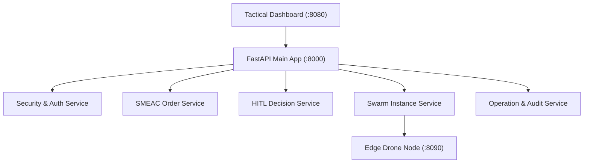
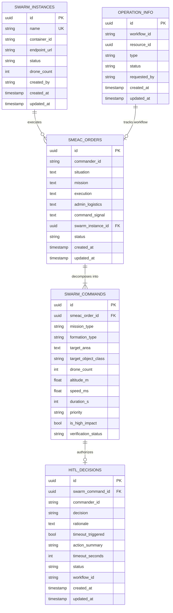

# Intent-Swarm-Commander: System, Service & Entity Overview

This document provides a comprehensive technical overview of all micro-services, architectural modules, and database entities in **Intent-Swarm-Commander (ISC v0.2.0)**.

---

## 1. System Services Overview

The Intent-Swarm-Commander backend is organized into decoupled domain services following the [`uservice-template`](https://github.com/dotness/uservice-template) standard:



---

### 1.1 Security & Auth Gateway Service

* **Location**: [`src/uservice/security/`](file:///home/remi/Projects/Intent-Swarm-Commander/src/uservice/security/)
* **Key Components**:
  * [`routes.py`](file:///home/remi/Projects/Intent-Swarm-Commander/src/uservice/security/routes.py): Authenticates commanders and issues JIT tokens.
  * [`jit.py`](file:///home/remi/Projects/Intent-Swarm-Commander/src/uservice/security/jit.py): Dynamic, time-bounded Just-In-Time token issuance.
  * [`middleware.py`](file:///home/remi/Projects/Intent-Swarm-Commander/src/uservice/security/middleware.py): Intercepts all requests; fails closed if Authorization header is invalid or lacks required scopes.
  * [`proxy.py`](file:///home/remi/Projects/Intent-Swarm-Commander/src/uservice/security/proxy.py): Transparent HTTP reverse proxy for edge telemetry.
  * [`jwt.py`](file:///home/remi/Projects/Intent-Swarm-Commander/src/uservice/security/jwt.py): HS256 / RS256 token verification, claims validation, and expiration enforcement.
* **API Endpoints**:
  * `POST /api/v1/auth/login`: Authenticate commander passphrase; return ephemeral Bearer token with granted scopes.

---

### 1.2 SMEAC Order Service

* **Location**: [`src/uservice/smeac/`](file:///home/remi/Projects/Intent-Swarm-Commander/src/uservice/smeac/)
* **Key Components**:
  * [`routes.py`](file:///home/remi/Projects/Intent-Swarm-Commander/src/uservice/smeac/api/routes.py): RESTful API exposing order creation and status queries.
  * [`facade/smeac.py`](file:///home/remi/Projects/Intent-Swarm-Commander/src/uservice/smeac/facade/smeac.py): Domain coordinator managing transactional order persistence and Temporal workflow dispatch.
  * [`operations/smeac_agents.py`](file:///home/remi/Projects/Intent-Swarm-Commander/src/uservice/smeac/operations/smeac_agents.py): Pydantic-AI agent analyzing SMEAC text and decomposing it into `SwarmCommandDTO` objects.
  * [`operations/process.py`](file:///home/remi/Projects/Intent-Swarm-Commander/src/uservice/smeac/operations/process.py): Temporal workflow orchestrating parsing, safety checks, and signals.
  * [`operations/safety_activity.py`](file:///home/remi/Projects/Intent-Swarm-Commander/src/uservice/smeac/operations/safety_activity.py): Guardian Critic Temporal activity invoking constraint solvers.
* **API Endpoints**:
  * `POST /api/v1/smeac`: Submit a new structured SMEAC order (`smeac:create` scope).
  * `GET /api/v1/smeac`: List submitted orders (`smeac:read` scope).
  * `GET /api/v1/smeac/{order_id}`: Retrieve detailed order status, generated commands, and violations.

---

### 1.3 HITL (Human-in-the-Loop) Service

* **Location**: [`src/uservice/hitl/`](file:///home/remi/Projects/Intent-Swarm-Commander/src/uservice/hitl/)
* **Key Components**:
  * [`routes.py`](file:///home/remi/Projects/Intent-Swarm-Commander/src/uservice/hitl/api/routes.py): Endpoints for pending decision queries and decision submissions.
  * [`facade/hitl.py`](file:///home/remi/Projects/Intent-Swarm-Commander/src/uservice/hitl/facade/hitl.py): Validates commander signoffs, updates decision records, and signals active Temporal workflows.
* **API Endpoints**:
  * `GET /api/v1/hitl/pending`: Poll active decisions awaiting commander signoff (`hitl:read` scope).
  * `POST /api/v1/hitl/decide`: Submit human approval or rejection with rationale (`hitl:decide` scope).
  * `GET /api/v1/hitl/{decision_id}`: Inspect historical decision audit details.

---

### 1.4 Swarm Fleet & Instance Service

* **Location**: [`src/uservice/swarm/`](file:///home/remi/Projects/Intent-Swarm-Commander/src/uservice/swarm/)
* **Key Components**:
  * [`routes.py`](file:///home/remi/Projects/Intent-Swarm-Commander/src/uservice/swarm/api/routes.py): Swarm pool lifecycle and command dispatch.
  * [`facade/swarm.py`](file:///home/remi/Projects/Intent-Swarm-Commander/src/uservice/swarm/facade/swarm.py): Manages swarm registration and forwards commands to edge nodes.
  * [`operations/swarm_agents.py`](file:///home/remi/Projects/Intent-Swarm-Commander/src/uservice/swarm/operations/swarm_agents.py): Deterministic constraint checking for altitude, duration, density, and geofences.
* **API Endpoints**:
  * `POST /api/v1/swarm`: Register a new swarm instance pool.
  * `GET /api/v1/swarm`: List active swarm pools and capacities.
  * `GET /api/v1/swarm/{swarm_id}`: Retrieve detailed swarm health and status.
  * `DELETE /api/v1/swarm/{swarm_id}`: Terminate and release a swarm instance.
  * `POST /api/v1/swarm/{swarm_id}/commands/{command_id}/dispatch`: Dispatch a verified command to edge nodes.

---

### 1.5 Operation & Audit Service

* **Location**: [`src/uservice/operation/`](file:///home/remi/Projects/Intent-Swarm-Commander/src/uservice/operation/)
* **Key Components**:
  * [`facade.py`](file:///home/remi/Projects/Intent-Swarm-Commander/src/uservice/operation/facade.py): Coordinates asynchronous Temporal workflow lifecycles and creates tracking records.
  * [`audit.py`](file:///home/remi/Projects/Intent-Swarm-Commander/src/uservice/operation/audit.py): Logs security events, command approvals, and state modifications.
  * [`models.py`](file:///home/remi/Projects/Intent-Swarm-Commander/src/uservice/operation/models.py): Database entity mapping Temporal workflow execution IDs to business entities.

---

### 1.6 Tactical Dashboard & UI Service

* **Location**: [`src/dashboard/`](file:///home/remi/Projects/Intent-Swarm-Commander/src/dashboard/)
* **Key Components**:
  * [`index.html`](file:///home/remi/Projects/Intent-Swarm-Commander/src/dashboard/index.html): Dark-theme tactical command cockpit.
  * [`js/map.js`](file:///home/remi/Projects/Intent-Swarm-Commander/src/dashboard/js/map.js): Leaflet.js map layer displaying drones, waypoints, geofences, and target vectors.
  * [`js/hitl.js`](file:///home/remi/Projects/Intent-Swarm-Commander/src/dashboard/js/hitl.js): Modal overlay with live timeout countdown for high-impact signoffs.
  * [`js/auth_indicator.js`](file:///home/remi/Projects/Intent-Swarm-Commander/src/dashboard/js/auth_indicator.js): Real-time badge display showing remaining JIT token lifetime and active scopes.

---

### 1.7 Tactical Edge Drone Daemon

* **Location**: [`src/edge/`](file:///home/remi/Projects/Intent-Swarm-Commander/src/edge/)
* **Key Components**:
  * [`api/server.py`](file:///home/remi/Projects/Intent-Swarm-Commander/src/edge/api/server.py): Fast HTTP server (`:8090`) running on the drone companion computer.
  * [`navigation/flight_controller.py`](file:///home/remi/Projects/Intent-Swarm-Commander/src/edge/navigation/flight_controller.py): MAVSDK client controlling arming, takeoff, waypoint navigation, and RTL via PX4.
  * [`vision/camera.py`](file:///home/remi/Projects/Intent-Swarm-Commander/src/edge/vision/camera.py): Thread-safe video capture supporting CSI cameras (RPi Camera v3), USB webcams, or synthetic frames.
  * [`vision/inference.py`](file:///home/remi/Projects/Intent-Swarm-Commander/src/edge/vision/inference.py): Real-time YOLO-E computer vision model for target identification.
* **Edge API Endpoints**:
  * `POST /target`: Assign an object class for optical identification (e.g. `vehicle`, `person`).
  * `GET /target`: Query active target assignment and detection count.
  * `GET /telemetry`: Return live telemetry JSON (battery %, lat/lon/alt, heading, speed).
  * `POST /flight/execute`: Trigger autonomous waypoint navigation.

---

## 2. Entity Catalog & Data Dictionary

### 2.1 Entity Relationship (ER) Diagram



---

### 2.2 Data Dictionary

#### Entity: `SmeacOrder` (`smeac_orders`)
Represents the commander's high-level military intent order.

| Column | Type | Nullable | Default | Description |
| :--- | :--- | :--- | :--- | :--- |
| `id` | UUID | No | `uuid_generate_v4()` | Primary key |
| `commander_id` | VARCHAR(255) | No | - | Identifier of the commander who submitted the order |
| `situation` | TEXT | No | - | Tactical situational description (threats, weather, terrain) |
| `mission` | TEXT | No | - | Clear operational objective statement |
| `execution` | TEXT | No | - | Tactical concept of operations and coordination instructions |
| `admin_logistics`| TEXT | Yes | `NULL` | Supply, maintenance, and logistics plan |
| `command_signal` | TEXT | Yes | `NULL` | Radio frequencies, passcodes, and command succession |
| `swarm_instance_id`| UUID | No | - | Foreign key -> `swarm_instances.id` |
| `status` | VARCHAR(64) | No | `'submitted'` | Order lifecycle state |
| `created_at` | TIMESTAMPTZ | No | `NOW()` | Submission timestamp |
| `updated_at` | TIMESTAMPTZ | No | `NOW()` | Timestamp of last status change |

##### State Transitions:
```
draft ──► submitted ──► parsing ──► translated ──► verified ──► executing ──► completed
                                        │             │                       ▲
                                        │             ▼                       │
                                        ▼         pending_hitl ───────────────┘
                                     rejected          │  (approved)
                                                       ▼
                                                    rejected (rejected / timeout)
```

---

#### Entity: `SwarmCommand` (`swarm_commands`)
The atomic unit of execution derived from a SMEAC order.

| Column | Type | Nullable | Default | Description |
| :--- | :--- | :--- | :--- | :--- |
| `id` | UUID | No | `uuid_generate_v4()` | Primary key |
| `smeac_order_id` | UUID | No | - | Foreign key -> `smeac_orders.id` |
| `mission_type` | ENUM | No | - | `recon`, `patrol`, `strike`, `transport`, `escort`, `abort` |
| `formation_type` | ENUM | No | - | `line`, `wedge`, `diamond`, `spread`, `stack` |
| `target_area` | TEXT | No | - | Target area encoded as GeoJSON geometry string |
| `target_object_class` | VARCHAR(128) | Yes | `NULL` | YOLO-E target detection class (e.g. `'vehicle'`) |
| `drone_count` | INTEGER | No | - | Number of UAVs allocated to this command |
| `altitude_m` | FLOAT | Yes | `NULL` | Target operational altitude in meters Above Ground Level |
| `speed_ms` | FLOAT | Yes | `NULL` | Commanded cruise airspeed in m/s |
| `duration_s` | INTEGER | Yes | `NULL` | Estimated mission duration in seconds |
| `priority` | ENUM | No | `'normal'` | `critical`, `high`, `normal`, `low` |
| `is_high_impact` | BOOLEAN | No | `false` | True if mission is `strike` or `abort` (requires HITL) |
| `verification_status`| VARCHAR(64) | No | `'pending'` | `'pending'`, `'verified'`, `'rejected'` |

---

#### Entity: `HitlDecision` (`hitl_decisions`)
Records formal human commander approvals or rejections for high-impact actions.

| Column | Type | Nullable | Default | Description |
| :--- | :--- | :--- | :--- | :--- |
| `id` | UUID | No | `uuid_generate_v4()` | Primary key |
| `swarm_command_id`| UUID | No | - | Identifier of the gated command |
| `commander_id` | VARCHAR(255) | No | - | Identifier of the decision-maker |
| `decision` | VARCHAR(64) | No | - | `'approved'`, `'rejected'`, `'timeout_auto_rejected'` |
| `rationale` | TEXT | Yes | `NULL` | Human-entered justification or ROE reason |
| `timeout_triggered`| BOOLEAN | No | `false` | Flag indicating whether decision was made via timeout |
| `action_summary` | VARCHAR(512) | No | `""` | Summary of the proposed action displayed to commander |
| `timeout_seconds` | INTEGER | No | `600` | Allowed countdown duration before auto-reject |
| `status` | VARCHAR(64) | No | `'pending'` | `'pending'`, `'approved'`, `'rejected'` |
| `workflow_id` | VARCHAR(255) | Yes | `NULL` | Temporal workflow ID to receive the decision signal |
| `created_at` | TIMESTAMPTZ | No | `NOW()` | Gate initialization timestamp |
| `updated_at` | TIMESTAMPTZ | No | `NOW()` | Decision timestamp |

---

#### Entity: `SwarmInstance` (`swarm_instances`)
A registered, running pool of UAV assets.

| Column | Type | Nullable | Default | Description |
| :--- | :--- | :--- | :--- | :--- |
| `id` | UUID | No | `uuid_generate_v4()` | Primary key |
| `name` | VARCHAR(255) | No | - | Unique human-readable swarm identifier |
| `container_id` | VARCHAR(128) | Yes | `NULL` | Edge container or physical asset group ID |
| `endpoint_url` | VARCHAR(512) | Yes | `NULL` | Edge API endpoint (e.g. `http://192.168.1.100:8090`) |
| `status` | VARCHAR(64) | No | `'provisioning'` | `provisioning`, `ready`, `active`, `draining`, `terminated` |
| `drone_count` | INTEGER | No | - | Total number of drones available in this instance |
| `created_by` | VARCHAR(255) | No | - | User/agent who provisioned the swarm |
| `created_at` | TIMESTAMPTZ | No | `NOW()` | Registration timestamp |
| `updated_at` | TIMESTAMPTZ | No | `NOW()` | Last state change timestamp |

---

#### Entity: `OperationInfo` (`operation_info`)
Tracks asynchronous Temporal workflow executions.

| Column | Type | Nullable | Default | Description |
| :--- | :--- | :--- | :--- | :--- |
| `id` | UUID | No | `uuid_generate_v4()` | Primary key |
| `workflow_id` | VARCHAR(255) | No | - | Unique Temporal workflow identifier |
| `resource_id` | UUID | No | - | Target domain entity ID (e.g. `smeac_order_id`) |
| `type` | VARCHAR(64) | No | - | Workflow type (e.g. `'ProcessSmeacWorkflow'`) |
| `status` | ENUM | No | `'created'` | `created`, `ongoing`, `completed`, `failed` |
| `requested_by` | VARCHAR(255) | No | - | User or agent initiator |
| `created_at` | TIMESTAMPTZ | No | `NOW()` | Workflow start timestamp |
| `updated_at` | TIMESTAMPTZ | No | `NOW()` | Workflow last status update |

