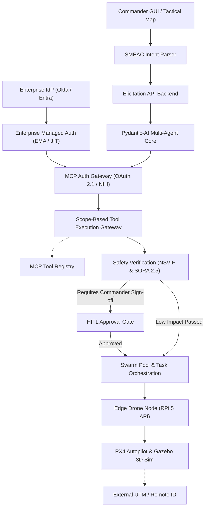
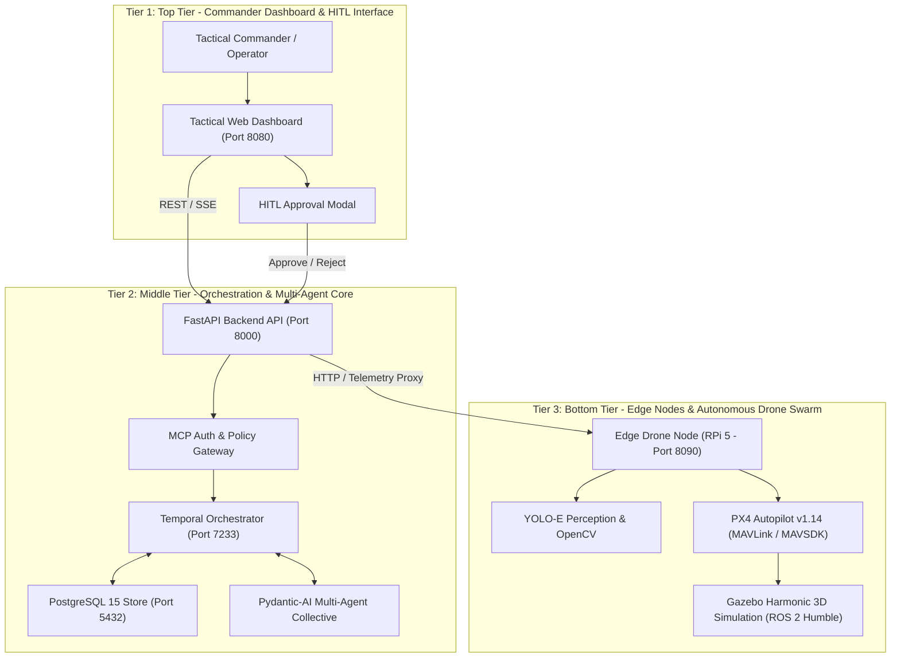

# Intent-Swarm-Commander: System Architecture

## 1. Executive Summary & Vision

**Intent-Swarm-Commander (ISC v0.2.0)** is an autonomous multi-drone command-and-control (C2) orchestration platform. It is engineered to translate high-level military intent orders (**SMEAC**: Situation, Mission, Execution, Administration/Logistics, Command/Signal) into resilient, coordinated multi-drone swarm operations. 

The system bridges strategic human decision-making with tactical autonomous drone swarms while enforcing:
* **EU AI Act & SORA 2.5 Compliance**: Deterministic Human-in-the-Loop (HITL) authorization gates for high-impact actions (strikes, aborts, ROE modifications).
* **Model Context Protocol (MCP)**: A centralized control plane enforcing cryptographic Just-In-Time (JIT) identity, Non-Human Identity (NHI) governance, and scope-based tool execution.
* **Formal Safety Verification**: Guardian Critic constraint satisfaction solvers (NSVIF) evaluating airspace, geofences, altitude ceilings, and drone densities before flight commands reach the physical swarm.
* **Durable Workflow Orchestration**: Fault-tolerant state machines via Temporal, ensuring zero state loss even across network partitions and system restarts.

---

## 2. The Compliant 7-Step Pipeline

ISC remediates traditional vulnerable C2 pipelines (`Worker -> Swarm Pool -> Drone`) by establishing a strictly governed 7-step pipeline:

### Pipeline Stages
1. **Commander GUI & Elicitation API**: The human operator inputs tactical SMEAC parameters into the Leaflet.js tactical dashboard ([`main.js`](file:///home/remi/Projects/Intent-Swarm-Commander/src/dashboard/js/main.js)).
2. **Multi-Agent Reasoning Core**: The Pydantic-AI agent collective ([`smeac_agents.py`](file:///home/remi/Projects/Intent-Swarm-Commander/src/uservice/smeac/operations/smeac_agents.py)) decomposes intent into coarse-grained operators with GeoJSON target geometries.
3. **MCP Auth Gateway**: The inbound execution request is intercepted by [`auth_gateway_middleware`](file:///home/remi/Projects/Intent-Swarm-Commander/src/uservice/security/middleware.py), validating OAuth 2.1 Bearer tokens and JIT ephemeral credentials ([`jit.py`](file:///home/remi/Projects/Intent-Swarm-Commander/src/uservice/security/jit.py)).
4. **MCP Tool Execution Gateway**: Enforces Role-Based Access Control (RBAC) and tool scopes (e.g. `smeac:create`, `hitl:decide`, `swarm:execute`).
5. **Safety Verification Layer (Guardian Critic)**: Deterministic constraint checking ([`safety_activity.py`](file:///home/remi/Projects/Intent-Swarm-Commander/src/uservice/smeac/operations/safety_activity.py)) validates altitude ceilings, prohibited airspace/geofences, and swarm density against SORA 2.5 safety envelopes.
6. **HITL Confirmation Gateway**: High-impact missions (`strike`, `abort`, ROE overrides) trigger an asynchronous approval workflow ([`hitl.py`](file:///home/remi/Projects/Intent-Swarm-Commander/src/uservice/hitl/facade/hitl.py)) presenting a modal on the commander console.
7. **Swarm Pool & Tactical Edge**: Approved commands are dispatched to edge drone nodes ([`server.py`](file:///home/remi/Projects/Intent-Swarm-Commander/src/edge/api/server.py)), driving MAVSDK flight controllers, YOLO-E computer vision, and PX4 Autopilots.

---

## 3. Tiered System Architecture

The architecture is partitioned into three decoupled operational tiers:

### Tier 1: Top Tier — Commander Dashboard & HITL Interface
* **Tactical Web UI ([`index.html`](file:///home/remi/Projects/Intent-Swarm-Commander/src/dashboard/index.html))**: Modern dark-theme mission interface rendered at `:8080`, powered by Leaflet.js for tactical GIS mapping.
* **SMEAC Intent Ingestion Panel ([`main.js`](file:///home/remi/Projects/Intent-Swarm-Commander/src/dashboard/js/main.js))**: Form inputs for entering Situation, Mission, Execution, Admin/Logistics, and Command/Signal.
* **HITL Approval Modal ([`hitl.js`](file:///home/remi/Projects/Intent-Swarm-Commander/src/dashboard/js/hitl.js))**: Prominent modal interrupting high-impact actions with real-time countdown timers.
* **Agent Identity & Scope Indicators ([`auth_indicator.js`](file:///home/remi/Projects/Intent-Swarm-Commander/src/dashboard/js/auth_indicator.js))**: Live badge display of JIT token lifespan and active permissions.

### Tier 2: Middle Tier — Mission Orchestration Engine
* **FastAPI Application ([`main.py`](file:///home/remi/Projects/Intent-Swarm-Commander/src/uservice/main.py))**: Clean architecture uService providing RESTful endpoints, CORS negotiation, and security proxying.
* **Temporal Workflow Engine ([`process.py`](file:///home/remi/Projects/Intent-Swarm-Commander/src/uservice/smeac/operations/process.py))**: Durable distributed workflow state machine (`:7233`) orchestrating parsing, safety validation, HITL signals, and command dispatch.
* **Pydantic-AI Multi-Agent Collective**:
  * **Planner Agent ([`smeac_agents.py`](file:///home/remi/Projects/Intent-Swarm-Commander/src/uservice/smeac/operations/smeac_agents.py))**: Deconstructs raw text orders into structured `SwarmCommandDTO` objects.
  * **Guardian Critic Agent ([`swarm_agents.py`](file:///home/remi/Projects/Intent-Swarm-Commander/src/uservice/swarm/operations/swarm_agents.py))**: Enforces rules of engagement, geofence boundaries, and altitude constraints.
* **State Store ([`engine.py`](file:///home/remi/Projects/Intent-Swarm-Commander/src/uservice/database/engine.py))**: PostgreSQL 15 database storing SMEAC orders, swarm instances, commands, and audit logs.
* **MCP Gateway & JIT Security ([`middleware.py`](file:///home/remi/Projects/Intent-Swarm-Commander/src/uservice/security/middleware.py), [`jit.py`](file:///home/remi/Projects/Intent-Swarm-Commander/src/uservice/security/jit.py))**: Fail-closed token validation and dynamic ephemeral credential manager.

### Tier 3: Bottom Tier — Tactical Edge Nodes & Autonomous Drone Swarms
* **Edge Compute Node ([`server.py`](file:///home/remi/Projects/Intent-Swarm-Commander/src/edge/api/server.py))**: Lightweight edge server (`:8090`) running on physical Raspberry Pi 5 hardware or local containers.
* **Onboard Computer Vision ([`inference.py`](file:///home/remi/Projects/Intent-Swarm-Commander/src/edge/vision/inference.py), [`camera.py`](file:///home/remi/Projects/Intent-Swarm-Commander/src/edge/vision/camera.py))**: Real-time object recognition using YOLO-E and OpenCV.
* **Flight Controller Bridge ([`flight_controller.py`](file:///home/remi/Projects/Intent-Swarm-Commander/src/edge/navigation/flight_controller.py))**: Async MAVSDK controller communicating with PX4 Autopilot over MAVLink.
* **Simulation & Physics Container ([`Dockerfile.drone_sim`](file:///home/remi/Projects/Intent-Swarm-Commander/Dockerfile.drone_sim))**: Headless or GUI Gazebo Harmonic 3D simulation with ROS 2 Humble and Micro XRCE-DDS bridge.

---

## 4. Key Subsystem Interactions

| Source Subsystem | Target Subsystem | Protocol | Purpose |
| :--- | :--- | :--- | :--- |
| Tactical Dashboard | FastAPI Backend | HTTP / JSON REST | SMEAC submission, telemetry polling, HITL decisions |
| FastAPI Backend | Temporal Server | gRPC (`:7233`) | Starting durable workflows, querying state, sending signals |
| FastAPI Backend | PostgreSQL | Asyncpg / SQL (`:5432`) | Domain entity persistence and transactional state |
| Temporal Worker | LLM Provider | HTTPS API (Gemini/OpenAI) | Pydantic-AI agent intent deconstruction |
| FastAPI Backend | Edge Drone API | HTTP REST (`:8090`) | Target assignments, command dispatch, telemetry proxy |
| Edge Drone API | PX4 Autopilot | MAVLink (UDP / Serial) | Waypoint navigation, takeoff, arming, RTL |
| PX4 Autopilot | Gazebo Simulation | Micro XRCE-DDS / ROS 2 | Real-time aerodynamics and sensor physics |

---

## 5. Architectural Documentation Roadmap

For in-depth technical analysis and specialized views of the system, refer to:
* **[Data Flows & Sequence Diagrams](file:///home/remi/Projects/Intent-Swarm-Commander/docs/data_flows.md)**: Step-by-step transaction flows for orders, HITL gates, and edge telemetry.
* **[Deployment Architecture](file:///home/remi/Projects/Intent-Swarm-Commander/docs/deployment.md)**: Hardware topology, container configuration, ports, and edge runtime specs.
* **[Domain-Driven Design (DDD)](file:///home/remi/Projects/Intent-Swarm-Commander/docs/domain_driven_design.md)**: Bounded contexts, context maps, domain models, and aggregates.
* **[System & Entity Overview](file:///home/remi/Projects/Intent-Swarm-Commander/docs/service_and_entity_overview.md)**: Detailed catalog of services, database schemas, and entity lifecycles.
* **[PMA Integration Analysis](file:///home/remi/Projects/Intent-Swarm-Commander/docs/analysis/compatibility_with_pma.md)**: Strategic compatibility study with Poor-Man's Artemis.IA data lakehouse.
