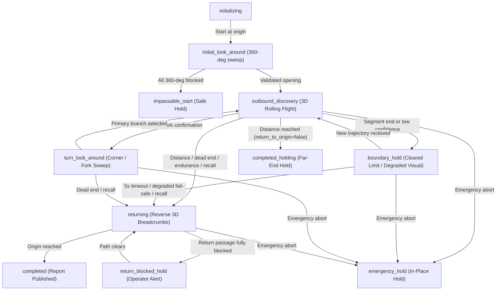

# Data Model: Gradual Corridor Path Discovery and Adaptive Survey

**Feature**: `012-corridor-path-discovery` | **Date**: `2026-11-19` | **Spec**: [spec.md](file:///home/remi/Projects/Intent-Swarm-Commander/specs/012-corridor-path-discovery/spec.md)

## 1. SMEAC Order Extension (`src/uservice/smeac/`)

### `CorridorSurveyParams` (Embedded JSON in `SwarmCommand.survey_params`)
Represents the validated coordinate-free survey specification parsed from a SMEAC order (`MissionType.CORRIDOR_SURVEY`).

| Field | Type | Constraints | Description |
|-------|------|-------------|-------------|
| `target_distance_m` | `float` | `> 0.0`, default `20.0` (no upper cap) | Ordered cumulative 3D path distance to survey; non-positive rejected (`422`) |
| `distance_defaulted` | `bool` | Default `False` | `True` when order omitted an explicit distance and `20.0 m` default was applied |
| `return_to_origin` | `bool` | Default `True` | `"go back"` return-to-origin directive (defaults `True` unless explicit far-end hold) |
| `corridor_descriptor` | `string` | Non-empty, max `256` chars | Natural-language context (e.g., `"corridor"`, `"tunnel"`, `"alleyway"`) |
| `intelligence_focus` | `list[string]` | Optional, default `[]` | Objects/hazards of intelligence interest to capture and highlight (`FR-016`) |
| `min_altitude_m` | `float` | `>= 0.5`, `< max_altitude_m`, default `1.2` | Configurable lower floor altitude safety bound (`FR-021`) |
| `max_altitude_m` | `float` | `> min_altitude_m`, `<= 120.0`, default `8.0` | Configurable upper ceiling altitude safety bound (`FR-021`) |
| `cruise_speed_ms` | `float` | `0.3 <= x <= 5.0`, default `1.5` | Nominal forward rolling survey speed |

### `SwarmCommand` & `GeoJsonTargetArea` Extension
- `MissionType`: adds `CORRIDOR_SURVEY = "corridor_survey"`.
- `GeoJsonTargetArea`: allows `type = "RelativeCorridor"` with `coordinates = []` (coordinate-free orders never require or hallucinate GPS coordinates).
- `SwarmCommand.survey_params`: nullable `Text` column storing serialized `CorridorSurveyParams` JSON (`ALTER TABLE swarm_commands ADD COLUMN IF NOT EXISTS survey_params TEXT`).
- `SwarmCommand.altitude_m` / `entry_altitude_m` (`FR-021`): when `altitude_m` is omitted (`None`), it defaults to `clamp(2.5, min_altitude_m, max_altitude_m)` and is forwarded as `entry_altitude_m` in `POST /corridor-survey/start`; any explicitly ordered `altitude_m` outside `[min_altitude_m, max_altitude_m]` fails closed with HTTP `422 Unprocessable Entity`.

---

## 2. PostgreSQL Persistent Entities (`src/uservice/corridor/models/storage/survey.py`)

### 2.1 `CorridorSurvey` (`corridor_surveys`)
Root aggregate representing a coordinate-free 3D adaptive corridor survey execution and its materialized intelligence record.

| Field | Type | Constraints | Description |
|-------|------|-------------|-------------|
| `id` | `UUID` | Primary Key | Canonical survey identifier (`survey_id`) |
| `project_id` | `String(64)` | Indexed, default `"default-theater"` | Theater / project isolation key |
| `swarm_instance_id` | `UUID` | FK/Indexed, not null | Owning swarm instance |
| `smeac_order_id` | `UUID` | FK/Indexed, not null | Originating SMEAC order |
| `command_id` | `UUID` | Indexed, not null | Originating `SwarmCommand` ID |
| `lead_scout_drone_id` | `String(64)` | Not null, default `"drone-1"` | Designated scout drone executing corridor entry (`FR-019`) |
| `staging_hold_drone_ids` | `JSONB` | Not null, default `[]` | Swarm drones held safely at staging/entrance (`FR-019`) |
| `corridor_descriptor` | `String(256)` | Not null | Corridor/passage label from SMEAC order |
| `requested_distance_m` | `Float` | `> 0.0`, not null | Ordered survey distance (`20.0` if defaulted) |
| `distance_defaulted` | `Boolean` | Not null, default `False` | Indicates whether `20.0 m` default was applied |
| `surveyed_distance_m` | `Float` | `>= 0.0`, default `0.0` | Cumulative 3D path distance traversed outbound |
| `return_to_origin` | `Boolean` | Not null, default `True` | Whether reverse-path return is ordered |
| `min_altitude_m` | `Float` | Not null | Enforced 3D lower altitude envelope (`FR-021`) |
| `max_altitude_m` | `Float` | Not null | Enforced 3D upper altitude envelope (`FR-021`) |
| `intelligence_focus` | `JSONB` | Not null, default `[]` | Target/hazard descriptors of intelligence interest |
| `phase` | `String(48)` | Not null, default `"initializing"` | Current state machine phase |
| `status` | `String(32)` | Not null, default `"dispatched"` | Lifecycle status: `dispatched \| active \| completed \| aborted \| impassable_start` |
| `completion_reason` | `String(64)` | Nullable | `distance_reached \| dead_end \| impassable_start \| guidance_timeout_failsafe \| endurance_reserve \| visual_degraded \| operator_recall \| operator_emergency_abort \| return_blocked \| far_end_hold` |
| `origin_pose` | `JSONB` | Nullable | Reference origin `{lat, lon, abs_alt_m, rel_alt_m, initial_heading_deg}` |
| `discovered_path` | `JSONB` | Not null, default `[]` | Ordered list of `PathBreadcrumb3D` dictionaries forming the verified 3D corridor |
| `structural_features` | `JSONB` | Not null, default `[]` | Summarized turns, width changes, overhangs, slopes, dead ends |
| `unexplored_branches` | `JSONB` | Not null, default `[]` | Unexplored fork/junction branches `{relative_pose, heading_deg, snapshot_id, estimated_width_m}` |
| `created_at` | `DateTime(tz)` | Not null | UTC creation timestamp |
| `updated_at` | `DateTime(tz)` | Not null | Last telemetry update timestamp |
| `completed_at` | `DateTime(tz)` | Nullable | UTC completion/termination timestamp |

### 2.2 `CorridorSnapshot` (`corridor_snapshots`)
Persists metadata for **every** captured visual snapshot across 360° look-around, outbound flight, boundary/turn holds, and return flight (`FR-020`).

| Field | Type | Constraints | Description |
|-------|------|-------------|-------------|
| `id` | `UUID` | Primary Key | Snapshot UUID (matches MinIO object filename `{snapshot_id}.jpg`) |
| `survey_id` | `UUID` | FK → `corridor_surveys.id`, indexed | Parent survey |
| `drone_id` | `String(64)` | Not null | Capturing drone (`lead_scout_drone_id`) |
| `sequence_num` | `Integer` | `>= 1`, not null | Monotonic per-survey capture sequence |
| `phase` | `String(48)` | Not null | Phase at capture (`initial_look_around`, `outbound_discovery`, `boundary_hold`, `turn_look_around`, `returning`, `return_blocked_hold`) |
| `captured_at` | `DateTime(tz)` | Not null | Capture timestamp (UTC) |
| `rel_x_m` | `Float` | Not null | Relative East displacement from origin (m) |
| `rel_y_m` | `Float` | Not null | Relative North displacement from origin (m) |
| `rel_z_m` | `Float` | Not null | Relative altitude above start ground (m) |
| `heading_deg` | `Float` | `0.0 <= x < 360.0` | Camera yaw/heading at capture time |
| `cumulative_distance_m` | `Float` | `>= 0.0` | Cumulative 3D path distance at capture |
| `visual_confidence` | `Float` | `0.0 <= x <= 1.0` | Composite sharpness/luminance/non-frozen visual quality score |
| `corridor_open` | `Boolean` | Not null | Whether navigable passage was detected |
| `estimated_width_m` | `Float` | Nullable | Estimated local corridor horizontal width (m) |
| `estimated_height_m` | `Float` | Nullable | Estimated vertical clearance/headroom (m) |
| `analysis_latency_ms` | `Float` | `>= 0.0` | Edge frame analysis duration (`SC-007` target `<= 500 ms`) |
| `snapshot_uri` | `Text` | Not null | Canonical `s3://tactical-snapshots/.../{snapshot_id}.jpg` URI |
| `byte_size` | `Integer` | `> 0`, `<= 5242880` | Validated JPEG payload size (bytes) |
| `structural_tags` | `JSONB` | Not null, default `[]` | Detected cues (`turn_left`, `turn_right`, `overhang`, `slope`, `fork`, `dead_end`, `blur`, `dark`, `frozen`) |

### 2.3 `CorridorTrajectoryDecision` (`corridor_trajectory_decisions`)
Auditable record linking every edge trajectory command or operator override directly to the snapshot(s) that triggered it (`FR-014`).

| Field | Type | Constraints | Description |
|-------|------|-------------|-------------|
| `id` | `UUID` | Primary Key | Decision event identifier |
| `survey_id` | `UUID` | FK → `corridor_surveys.id`, indexed | Parent survey |
| `sequence_num` | `Integer` | `>= 1`, not null | Monotonic decision index per survey |
| `decision_authority` | `String(32)` | `"edge" \| "commander"` | Authority origin (`FR-014`) |
| `command_source` | `String(64)` | `"edge_corridor_survey" \| "operator_corridor_override"` | Provenance discriminator |
| `action` | `String(48)` | Enum | `initial_trajectory \| trajectory_update \| turn_look_around \| boundary_hold \| altitude_adjust \| branch_select \| return_start \| return_segment \| failsafe_return \| operator_recall \| operator_emergency_abort` |
| `from_phase` | `String(48)` | Not null | Previous survey phase |
| `to_phase` | `String(48)` | Not null | Next survey phase |
| `target_rel_x_m` | `Float` | Not null | Commanded local 3D target X (m) |
| `target_rel_y_m` | `Float` | Not null | Commanded local 3D target Y (m) |
| `target_rel_z_m` | `Float` | Not null | Commanded local 3D altitude Z (m), clamped within `[min_altitude_m, max_altitude_m]` |
| `commanded_heading_deg` | `Float` | `0.0 <= x < 360.0` | Commanded yaw heading |
| `cleared_distance_m` | `Float` | `>= 0.0` | Cleared horizon length ahead of drone |
| `speed_ms` | `Float` | `>= 0.0` | Commanded segment speed |
| `trigger_snapshot_ids` | `JSONB` | Not null | Non-empty list of triggering `CorridorSnapshot.id` UUIDs (for edge decisions) |
| `analysis_latency_ms` | `Float` | Nullable | Snapshot-to-decision compute latency (ms) |
| `rationale` | `Text` | Not null | Human-readable reasoning / override summary |
| `created_at` | `DateTime(tz)` | Not null | Decision UTC timestamp |

### 2.4 `CorridorFinding` (`corridor_findings`)
Structured intelligence observations discovered along the corridor (`FR-011`, `FR-012`, `FR-016`).

| Field | Type | Constraints | Description |
|-------|------|-------------|-------------|
| `id` | `UUID` | Primary Key | Finding identifier |
| `survey_id` | `UUID` | FK → `corridor_surveys.id`, indexed | Parent survey |
| `finding_type` | `String(32)` | Enum | `target_interest \| hazard \| obstacle \| side_branch \| structural_feature \| dead_end` |
| `label` | `String(128)` | Not null | Object class or feature label (e.g., `"corner_right"`, `"low_overhang"`, `"backpack"`, `"unexplored_left_branch"`) |
| `confidence` | `Float` | `0.0 <= x <= 1.0` | Detection/classification confidence |
| `matches_mission_interest` | `Boolean` | Not null, default `False` | `True` when matched against `intelligence_focus` (`FR-016`) |
| `rel_x_m` | `Float` | Not null | Relative 3D East position |
| `rel_y_m` | `Float` | Not null | Relative 3D North position |
| `rel_z_m` | `Float` | Not null | Relative 3D altitude |
| `heading_deg` | `Float` | `0.0 <= x < 360.0` | Bearing toward finding/branch |
| `cumulative_distance_m` | `Float` | `>= 0.0` | Distance along discovered corridor |
| `snapshot_id` | `UUID` | FK → `corridor_snapshots.id`, nullable | Supporting snapshot ID |
| `details` | `JSONB` | Not null, default `{}` | Additional geometry/bbox/branch metadata |
| `detected_at` | `DateTime(tz)` | Not null | Detection UTC timestamp |

---

## 3. Edge In-Memory Domain Types (`src/edge/`)

- **`CorridorBranchCandidate`**: `{azimuth_offset_deg: float, elevation_offset_m: float, openness_score: float, estimated_width_m: float, estimated_height_m: float}`
- **`CorridorFrameAnalysis`**: `{visual_confidence: float, blur_score: float, brightness_score: float, is_frozen: bool, corridor_open: bool, is_dead_end: bool, primary_branch: CorridorBranchCandidate | None, secondary_branches: list[CorridorBranchCandidate], structural_tags: list[str], target_findings: list[dict], hazards: list[dict], analysis_latency_ms: float}`
- **`PathBreadcrumb3D`**: `{index: int, rel_x_m: float, rel_y_m: float, rel_z_m: float, heading_deg: float, cumulative_distance_m: float, estimated_width_m: float, estimated_height_m: float, snapshot_id: str}`
- **`EdgeTrajectoryInstruction`**: `{instruction_id: str, action: str, target_rel_x_m: float, target_rel_y_m: float, target_rel_z_m: float, commanded_heading_deg: float, cleared_distance_m: float, speed_ms: float, trigger_snapshot_ids: list[str], rationale: str, analysis_latency_ms: float}`

---

## 4. MinIO Object Storage Layout & Validation Rules

- **Bucket**: `tactical-snapshots` (existing bucket managed by `MinioStore`).
- **Key Format**: `projects/{project_id}/swarms/{swarm_id}/corridor-surveys/{survey_id}/drones/{drone_id}/{snapshot_id}.jpg`
- **Security & Validation**:
  - `project_id` validated against `^[a-z0-9](?:[a-z0-9-]{0,62}[a-z0-9])?$`.
  - `swarm_id`, `survey_id`, and `snapshot_id` validated as canonical UUID strings.
  - `drone_id` validated against `^[a-zA-Z0-9_-]{1,64}$`.
  - All object keys pass `validate_object_key()` (rejecting `..`, leading `/`, `\`, null bytes).
  - Uploaded snapshot bytes MUST begin with JPEG magic bytes (`\xff\xd8\xff`) and be `<= 5 MB`.
  - **Retention Scope**: Every captured snapshot is persisted without pruning; TTL expiration and cleanup are explicitly out of scope (`FR-020`).

---

## 5. 3D Corridor Survey State Transitions

### 5.1 Canonical `SurveyPhase` -> `flight_status` Telemetry Mapping

Every `CorridorSurvey` state emits an exact 1-to-1 `SwarmTelemetryEvent.flight_status` equal to `f"survey_{phase}"` (plus `"survey_staging_hold"` for non-scout swarm drones held safely at staging per `FR-019`). All corridor telemetry statuses satisfy `flight_status.startswith("survey_")` and never emit `"approaching"`, guaranteeing zero mid-corridor HITL blocking pauses (`FR-016`):

| `SurveyPhase` / Role | Telemetry `flight_status` | Operational Semantics |
|---|---|---|
| `initializing` | `survey_initializing` | Controller instantiated at origin prior to takeoff/sweep |
| `initial_look_around` | `survey_initial_look_around` | Hovering at origin across 8-heading `360°` yaw sweep (`SC-002`) |
| `impassable_start` | `survey_impassable_start` | No open heading across `360°` at start; holding safely at origin |
| `outbound_discovery` | `survey_outbound_discovery` | Continuous rolling 3D flight along edge-cleared corridor segments |
| `boundary_hold` | `survey_boundary_hold` | Holding safely at cleared segment limit / degraded visual recapture (`5.0 s` failsafe timer active) |
| `turn_look_around` | `survey_turn_look_around` | Sweeping/re-capturing at corner, curve, or fork junction before primary continuation |
| `returning` | `survey_returning` | Autonomous or recalled reverse-path retracing along verified `PathBreadcrumb3D` sequence |
| `return_blocked_hold` | `survey_return_blocked_hold` | Return passage obstructed; holding safely with operator alert (`FR-010`) |
| `emergency_hold` | `survey_emergency_hold` | Operator emergency abort active; immediate in-place hold via `action.hold()` (`FR-018`) |
| `completed` | `survey_completed` | Return-to-origin finished and `CorridorIntelligenceReport` compiled |
| `completed_holding` | `survey_completed_holding` | Survey finished at far end (`return_to_origin=false`); holding safely |
| Non-scout staging drones (`FR-019`) | `survey_staging_hold` | Remaining swarm drones held safely at entrance/staging with prior tasks cancelled |
